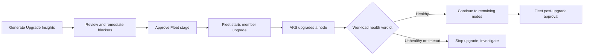
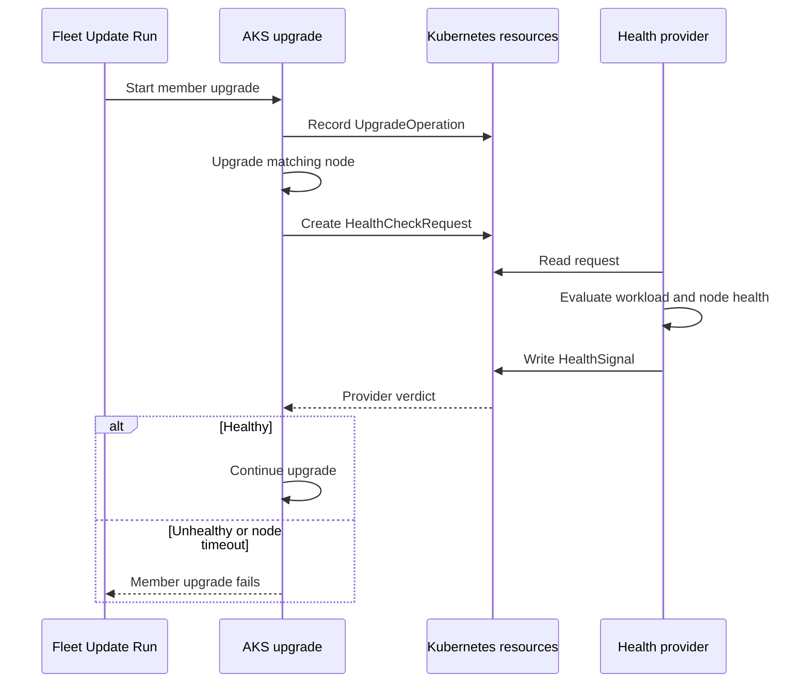

# Step 4: Add an AKS upgrade health gate

Readiness is a prediction before an upgrade. Workload health is evidence collected while it happens. A PDB can protect replica availability and still miss an application returning errors or exceeding its latency budget.

[AKS upgrade health gates (preview)](https://learn.microsoft.com/azure/aks/upgrade-health-gates) connect those health signals to the node upgrade process itself. This isn't a CI job that runs after the entire cluster has upgraded. AKS asks a health provider for a verdict during the upgrade and stops if the verdict is unhealthy or times out. Allow about 20 minutes for setup, then keep this page open during Step 5.

## 4.1 Understand the two levels of protection

Fleet approval gates control when a stage or group can proceed. AKS health gates control progress within a member's node upgrade. Upgrade Insights is a separate preflight assessment, not either kind of gate.



The contract between AKS and the health provider uses four custom resources:



`UpgradeGatePolicy` selects the scope and provider. Every matching provider must answer **node-scoped** requests. Cluster and pool signals can act as additional circuit breakers but don't replace the per-node response.

## 4.2 Enable the preview and apply a policy

Use the Standard VMSS cluster from Step 1. Register the preview and wait for `Registered`:

```bash
az feature register --namespace Microsoft.ContainerService --name EnableUpgradeGatePreview
az feature show --namespace Microsoft.ContainerService --name EnableUpgradeGatePreview \
  --query properties.state -o tsv
```

```bash
az provider register --namespace Microsoft.ContainerService
az aks update --resource-group ${RG_NAME} --name ${AKS_NAME} --enable-upgrade-gate
az aks show --resource-group ${RG_NAME} --name ${AKS_NAME} \
  --query upgradeSettings.upgradeGateSettings -o yaml
kubectl get crd upgradegatepolicies.upgrade.aks.io upgradeoperations.upgrade.aks.io \
  healthcheckrequests.health.aks.io healthsignals.health.aks.io
```

Enabling the setting alone doesn't gate a pool: a matching policy is also required. Apply a cluster-scoped policy so you don't accidentally target a nonexistent node-pool name:

```bash
kubectl apply -f - <<'EOF'
apiVersion: upgrade.aks.io/v1alpha1
kind: UpgradeGatePolicy
metadata:
  name: lab-workload-health
spec:
  provider: lab-health
  rules:
  - target:
      scope: Cluster
    nodeTimeout: 5m
EOF
kubectl get upgradegatepolicy lab-workload-health -o yaml
```

The five-minute timeout gives you time to examine a request manually. It is the preview maximum, not a recommended latency budget for production. The supported failure action is `Abort`. Policies are snapshotted when an upgrade starts; editing one afterward doesn't change that operation.

We're deliberately acting as the health provider in this exercise. Don't leave this policy unattended: an unanswered node request stops the upgrade. A real deployment needs a controller or monitoring integration that answers requests automatically. The Microsoft-managed on-demand monitor, if enabled separately, has its own one-minute timeout; our five-minute policy doesn't extend it.

## 4.3 Prepare a verdict based on observed health

Don't start a separate `az aks upgrade`. In Step 5, Fleet will start the upgrade after you review Insights and approve its before-stage gate. Before granting that approval, open a second terminal and watch:

```bash
kubectl get upgradeoperation,healthcheckrequest,healthsignal --watch
```

When a request appears, inspect it and select a **node-scoped** request from the current operation, not a stale request or an optional cluster/pool request:

```bash
kubectl get healthcheckrequest
read -r -p "Current node-scoped health check request name: " HCR_NAME
kubectl get healthcheckrequest "${HCR_NAME}" -o yaml
kubectl get nodes -o wide
kubectl get deployment,pods,pdb -n upgrade-lab -o wide
kubectl rollout status deployment/pdb-blocked-api -n upgrade-lab --timeout=60s
```

Check the requested node's readiness and the workload's available replicas and readiness. For this sample nginx workload, test HTTP through a port-forward in another terminal:

```bash
kubectl port-forward -n upgrade-lab deployment/pdb-blocked-api 8080:80
```

```bash
curl --fail --show-error http://127.0.0.1:8080/
```

Stop the port-forward with Ctrl+C afterward. This is a deliberately small smoke test, not proof of application-wide availability. Real providers should evaluate the application's own service endpoints, error rates, latency, and compatibility tests.

Only when the checks pass, create the response associated with this exact request:

```bash
HCR_UID=$(kubectl get healthcheckrequest "${HCR_NAME}" -o jsonpath='{.metadata.uid}')
kubectl apply -f - <<EOF
apiVersion: health.aks.io/v1alpha1
kind: HealthSignal
metadata:
  name: ${HCR_NAME}-lab-health
  labels:
    health.aks.io/provider: lab-health
  ownerReferences:
  - apiVersion: health.aks.io/v1alpha1
    kind: HealthCheckRequest
    name: ${HCR_NAME}
    uid: ${HCR_UID}
    controller: true
    blockOwnerDeletion: true
spec:
  type: NodeHealth
EOF
kubectl patch healthsignal "${HCR_NAME}-lab-health" \
  --subresource=status --type=merge \
  -p "{\"status\":{\"conditions\":[{\"type\":\"Ready\",\"status\":\"True\",\"reason\":\"SmokeTestPassed\",\"message\":\"Lab node and workload checks passed\",\"lastTransitionTime\":\"$(date -u +%FT%TZ)\"}]}}"
```

The provider label and owner reference are essential: AKS ignores an unmatched signal. Repeat for **each new node request** while Fleet runs. A single `True` response isn't permission to skip the rest.

## 4.4 Understand the stop path

If a smoke test fails, don't publish `True`. A provider should report `False` with the actual failure reason, or AKS will stop when no valid verdict arrives within `nodeTimeout`. For an optional controlled failure on this disposable cluster, create the same request-linked signal but patch its condition to `False` with reason `LabSimulatedFailure` instead of publishing a healthy condition. Label this as a simulation, not a detected application defect.

A stopped upgrade doesn't roll back nodes already upgraded, and a control-plane-only upgrade isn't gated. Inspect `kubectl get nodes` rather than assuming the node pool's target version means every node reached it. Correct the health issue before retrying; new operations require new responses. In the Fleet flow, inspect the failed member and use the run's supported retry controls rather than bypassing orchestration with an unrelated cluster upgrade.

Both enablement and the policy are AKS settings, independent of the client that requests the upgrade. The public docs describe full-cluster and node-pool upgrade support but don't provide a separate Fleet-specific preview walkthrough. Confirm that the Fleet-triggered member operation actually creates these requests; no requests means this lab has not demonstrated health gating.

---

Next: [Step 5 - Drive the upgrade with Fleet](./fleet-orchestration)
